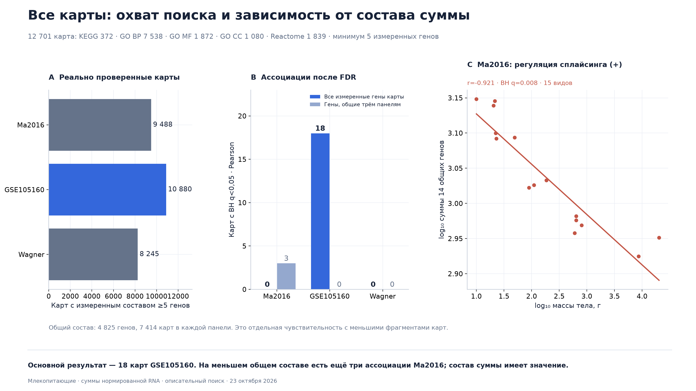

# Body-mass transcriptomics

Code and selected results for **Adult body size is associated with distinct transcriptional signatures in avian epiblast and primary fibroblasts**.

Ilya Rubinshteyn, Ruslan Deviatiiarov, Oleg Gusev and Guojun Sheng.

We examined how expression associated with adult body mass can be resolved into interpretable gene groups and candidate regulatory programmes in birds and mammals. The project includes gene-level checks, pathway sums and group refinement, coexpression networks, promoter motifs, and predicted regulons. The poster presents selected results; the repository also exposes the broader searches and their robustness checks.

## Start with the results

The [results guide](docs/results.md) links the actual tables, analysis scope and limitations. It covers:

- Seven bird species, two cultures and nine selected gene groups, with submitted and corrected measurement versions kept separate.
- A catalogue of 12,701 functional maps tested across three mammalian panels: Ma2016 (15 species), GSE105160 (9), and Wagner (11), with panel-specific and common gene compositions distinguished.
- Descriptive correlations for 123 frozen coexpression modules across the three panels, alongside the earlier phylogenetic and broader multiple-testing results.
- Shared promoter-regulator searches, matched-background motif evidence and bounded negative results.
- Three pySCENIC seeds, target-set stability and module–regulon overlaps, including results that did not survive the sensitivity analyses.



The figure above is an existing result, not a new analysis performed during repository preparation. Full measured-map sums can already show associations. Refining a group can help identify its contributing components, but is not universally required to obtain an association.

## What is reproducible here?

**The bundled-data replay and selected numerical checks can run from a source checkout without the original research directories. Complete raw-input reconstruction of the study is not yet independently reproduced.**

```bash
git clone https://github.com/rljech13/body-mass-transcriptomics.git
cd body-mass-transcriptomics
python3.11 -m venv .venv
. .venv/bin/activate
python -m pip install -r environments/replay-requirements.txt
python -m bodymass --verify-data
python -m unittest discover -s tests -v
python -m bodymass figures all-maps --out results/all_maps
python -m bodymass figures refine-motifs --out results/motifs
```

This checks the packaged data, repeats the existing fit functions for 18 frozen bird associations, and renders the existing whole-map and motif figures. R stages also reproduce the 123 descriptive module tests and the saved regulon/target figures; see the [reproduction guide](docs/reproducibility.md) for their dependencies and commands.

The replay starts from frozen measurements and saved networks. It does not repeat CAGE reassignment, RNA quantification, WGCNA network discovery or GRNBoost2 training. The [reproduction guide](docs/reproducibility.md) lists the remaining gaps, including external raw inputs, reference versions and incomplete historical environment records.

## Five scientific workflows, one entry point

```bash
python -m bodymass --list
```

| Workflow | Purpose |
|---|---|
| `avian` | CAGE measurements, gene reassignment, expression matrices and gene-level checks |
| `groups` | Group refinement, fixed-group tests, functional-map associations and promoter analyses |
| `networks` | Expression preparation, WGCNA, descriptive summaries and sensitivity analyses |
| `scenic` | GRN inference, rankings, motif pruning, AUCell, overlaps and seed sensitivity |
| `figures` | Scientific panels and replay of saved whole-map, motif and regulon results |

For original-input analyses, copy `config/example.json` to `config/local.json`, configure the data roots, and use the [workflow/input guide](docs/workflows.md). `--plan` describes a stage without executing it. The optional editable installation is `python -m pip install --no-deps -e .`; the supported replay layout is the source checkout, not a standalone wheel.

Existing calculation bodies are in these modules. They do not dispatch to hidden numbered Python scripts. The original 164-script export remains in Git commit [`d230e56`](https://github.com/rljech13/body-mass-transcriptomics/tree/d230e56ab942305ec88fbfc04cc1ec8a7a6d67e2). [Source mappings](provenance/consolidation.json) and [selected result-object hashes](provenance/extended_results.json) distinguish the source versions, their historical evidence, and the packaged copies. Historical exploratory scripts have not all been converted to current CLI stages.

## Source data and interpretation

Avian fibroblasts: GSE213253. Mammalian fibroblasts: Ma et al. (2016), eLife 5:e19130, https://doi.org/10.7554/eLife.19130, plus the GSE105160 and Wagner panels identified in the saved input records. Avian epiblast measurements were supplied by the study authors; the selected metadata do not specify a public accession. Raw reads, genomes and large ranking databases remain external.

Selected groups, multiple-testing families, gene coverage, phylogeny and seed sensitivity are reported separately. Motif matches and predicted targets nominate regulatory candidates; they do not establish TF occupancy or causal control of body size. A reuse license and public access have not yet been selected by the authors.
