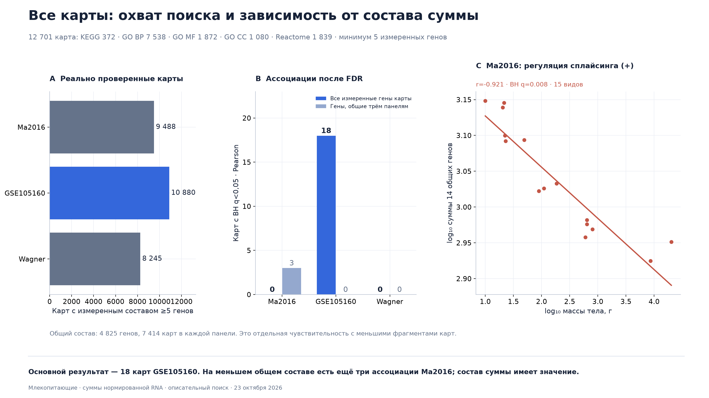
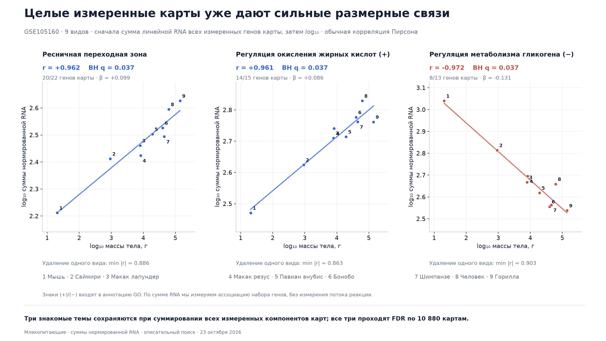
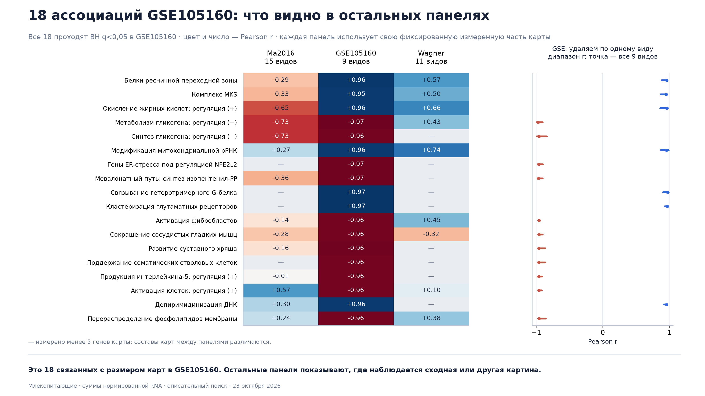

# Results beyond the poster

The project asks which components of heterogeneous expression patterns are associated with adult mass, and whether they form coherent functional or regulatory programmes. It does not establish that every association requires filtering, or that the selected genes causally determine size.

## Bird expression and group refinement

Seven bird species were compared in epiblast and fibroblast cultures. The repository retains the nine selected groups, their memberships and both submitted and corrected measurement versions:

- [Gene memberships](../data/frozen/gene_groups.tsv).
- [Bird points, both versions](../figures/figure_bank/data/bird_points.tsv) and [all corresponding tests](../figures/figure_bank/data/bird_tests.tsv).
- [Frozen poster input records](../data/frozen/poster_inputs.json).

The selected groups include metabolic pathways and coexpression-derived sets. Correcting measurement assignments and changing membership/filtering are separate operations. The nine-group BH family does not adjust away the earlier data-dependent gene selection. OXPHOS in epiblast remains filter-dependent; a negative result under one filter is not proof that the underlying process is absent.

The current code also exposes the existing gene-scan, gene-checks and epiblast-trait procedures. Group-component, motif and coverage procedures remain in the five modules. Earlier exploratory stages and alternative models are linked through the [original source inventory](../provenance/original_sources.json) and retained Git revision, rather than reintroduced as dozens of entry scripts.

## Whole functional maps across three mammalian panels

The catalogue contains 12,701 KEGG, GO and Reactome maps. With at least five measured genes, the panel-specific analyses tested 10,880 maps in GSE105160, 9,488 in Ma2016 and 8,245 in Wagner. Ordinary Pearson tests gave 18 BH-positive GSE105160 maps and none in the other two panels. Restricting to common gene composition gave 7,414 maps per panel: three BH-positive Ma2016 maps and none in the other panels. These are distinct search/composition families, not interchangeable estimates.

The Ma2016 splicing-related group shown in the poster is one of these common-composition results: 14 measured genes, r = −0.921 and q = 0.00824. Phylogenetic-model significance differs. A full measured-map sum already yields strong associations for several GSE105160 themes; refinement can explain which genes contribute rather than serving as a prerequisite for every detected relationship.

The [complete saved test table](../data/snapshots/all_maps/results/map_tests.tsv.gz), [BH hits](../data/snapshots/all_maps/results/Pearson_BH_hits.tsv), [species scores](../data/snapshots/all_maps/results/Pearson_hit_species_scores.tsv), [leave-one-species ranges](../data/snapshots/all_maps/results/shortlist_leave_one_species.tsv.gz), [gene-dominance diagnostics](../data/snapshots/all_maps/results/shortlist_gene_dominance.tsv.gz) and [search summary](../data/snapshots/all_maps/results/descriptive_summary.json) expose the broader result. “Measured map” means the measured subset of a canonical annotation, not necessarily every canonical gene.

## Coexpression and sensitivity to the statistical question

The frozen full-gene networks contain 41 non-grey Ma2016 modules, 28 GSE105160 modules and 54 Wagner modules. Descriptive ordinary correlations with within-panel BH identify four, one and zero modules, respectively. The poster's four Ma2016 modules belong to this descriptive analysis. The earlier broader phylogenetic analysis tested 743 module–mass associations across its full panel/model family and found none after its joint correction. These results have different models and correction families; the four descriptive associations do not overturn the broader null result.

The [123-module table](../data/snapshots/networks/data/module_mass_Pearson.tsv) preserves ordinary r/P, within-study and pooled BH, historical phylogenetic P/q, module size, annotation and leave-one-species diagnostics in separate columns. [Saved eigengenes](../data/snapshots/networks/data/saved_eigengenes.tsv), [memberships](../data/snapshots/networks/data/saved_members.tsv), [historical tests](../data/snapshots/networks/data/saved_historical_mass_tests.tsv) and [summary](../data/snapshots/networks/summary.json) make the descriptive recalculation inspectable.

The broader [robustness summary](../data/snapshots/robustness/summary.json) also records 309 module-transfer tests with no primary corrected hit, 100-tree sensitivity with no module significant on all trees, motif enrichment, and bounded TF–target tests. Not every historical sensitivity procedure has been replayed during packaging.

## Shared promoter regulators

Motif searches sought regulators shared by genes within the groups; OXPHOS was one displayed example. The [matched candidate evidence](../figures/figure_bank/data/motif_matched21.tsv) and [816-model screen](../figures/figure_bank/data/motif_broad816.tsv) retain different backgrounds and correction families. [Verified example windows](../figures/figure_bank/data/verified_NR_example_windows.tsv) and [sites](../figures/figure_bank/data/verified_NR_example_sites.tsv) document sequence-level examples.

In the broader run, 54,604 motif-enrichment tests yielded one joint-correction hit: an E2F2-like motif in a GSE105160 module, q = 0.01685. Across 62,423 motif-supported TF–target edge tests, the maximum corrected support was one target per TF/panel, below the prespecified ten-target regulon criterion. These are bounded search results, not evidence for a universal upstream size regulator or direct TF binding.

## Predicted regulation and three-seed stability

The primary Ma2016 pySCENIC run produced 187 regulons. ERG and FOXP4 had AUCell–mass associations in that primary run; those corrected associations did not persist across the additional seeds. Median primary-to-repeat target Jaccard was 0.0282 and 0.0392. No module–regulon pair was BH-positive in all three runs.

The [all-seed mass tests](../data/snapshots/scenic/mass_association_all_seeds.tsv), [target-set stability](../data/snapshots/scenic/regulon_stability.tsv), [pair stability](../data/snapshots/scenic/seed_stability.tsv), [overlaps for the primary seed](../data/snapshots/scenic/overlap_20261023.tsv) and [stability summary](../data/snapshots/scenic/stability_summary.json) show what survived and what did not. The [primary species activity](../figures/regulon_scatter/data/species_activity.tsv) and [target-expression snapshot](../figures/target_heatmap/data/species_gene_expression.tsv) support the plotted examples without implying stable causal regulation.

## How to use this material

The contribution is the explicit progression from measurements and gene membership to interpretable group associations, with coexpression and regulatory candidates assessed alongside coverage, model and stability checks. The saved outputs also show where that progression fails or depends on assumptions. The repository documents these existing results; it does not claim that aggregation/group refinement is a new general method or that the candidates experimentally regulate body size. Follow the [reproduction guide](reproducibility.md) to distinguish replayed calculations from saved results and full-input analyses that remain external.
